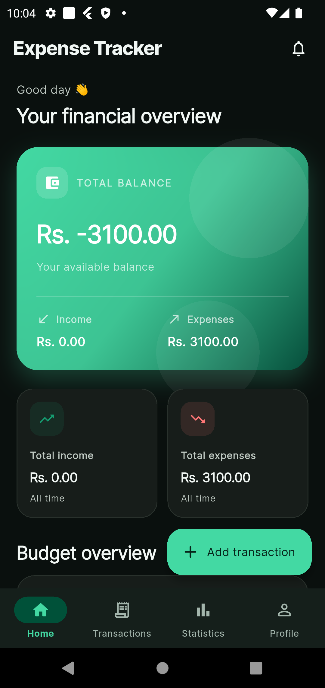
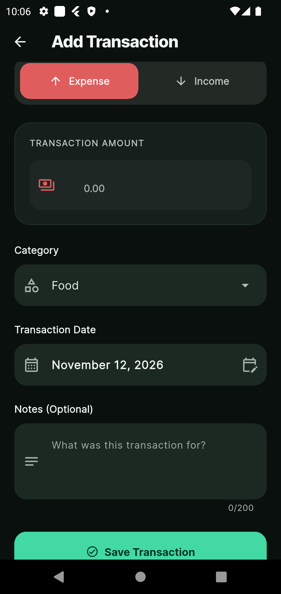
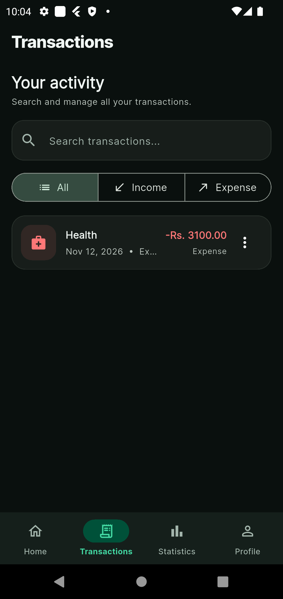
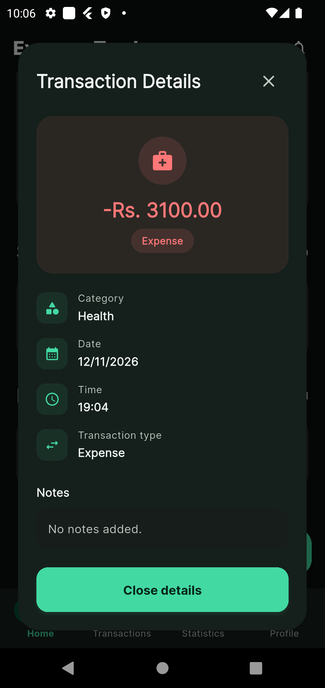
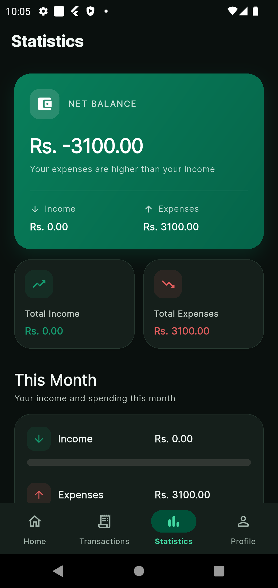
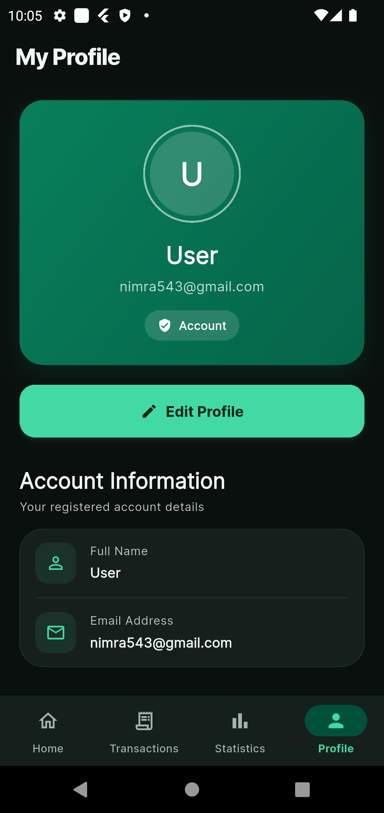
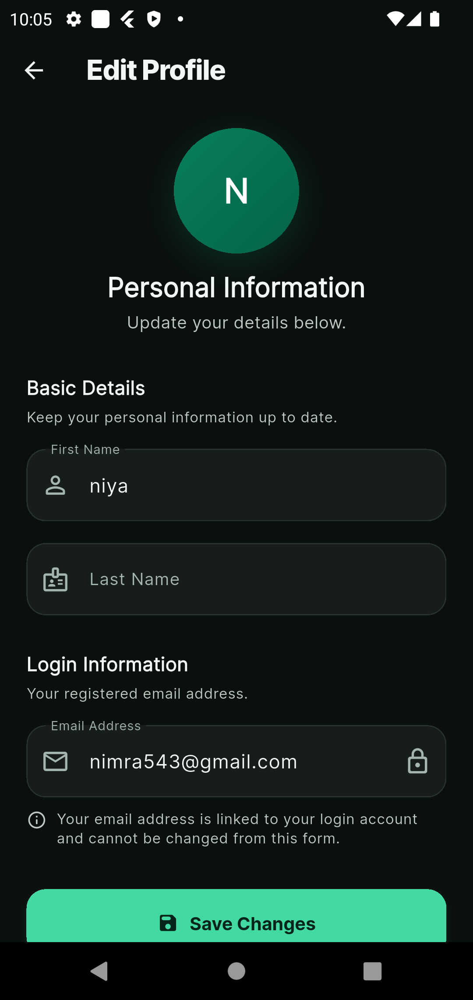

# Expense Tracker App

A modern, feature-rich personal finance management application built with **Flutter and Firebase**. Expense Tracker helps users manage their money, track income and expenses, monitor monthly budgets, and understand their spending habits through a clean, intuitive, and responsive mobile interface.

The application provides secure authentication, cloud-based financial records, transaction management, financial statistics, budget alerts, and light and dark theme support.

---

## Project Overview

Managing personal finances is an important part of everyday life. Expense Tracker was developed to make this process easier by bringing essential financial management features together in one mobile application.

Users can create an account, record their income and expenses, organize transactions, set a monthly budget, and monitor their financial activity through a personalized dashboard.

The application uses Firebase Authentication for user account management and Cloud Firestore to store financial records in the cloud. Local notifications help users stay aware of their daily financial activities and monthly spending limits.

The interface follows a modern design approach, with an emerald-green color palette, rounded cards, clear financial summaries, and support for both light and dark themes.

## Key Features

### 1. User Authentication

- Create an account using first name, last name, email, and password.
- Log in using registered credentials.
- Firebase Authentication integration.
- Personalized user profile.
- Secure logout functionality.
- User-specific financial data.

### 2. Financial Dashboard

The dashboard provides an overview of the user's financial situation.

- Display total income.
- Display total expenses.
- View available balance.
- Monitor monthly budget information.
- View recent transactions.
- Quickly access important financial information.

### 3. Transaction Management

Users can manage their financial records through a dedicated transaction management system.

- Add new income transactions.
- Add new expense transactions.
- Edit existing transactions.
- Delete transactions.
- Enter transaction amounts.
- Select transaction categories.
- Choose transaction dates.
- Add optional notes.
- View detailed transaction information.

### 4. Income and Expense Tracking

- Keep income and expenses organized.
- Monitor money received and spent.
- Review transaction history.
- Understand financial activity.
- View updated financial summaries.

### 5. Monthly Budget Management

The monthly budget feature helps users stay within their spending limits.

- Set a monthly spending budget.
- Monitor monthly expenses against the budget.
- Receive a budget threshold notification when spending reaches 80% of the configured budget.
- Receive a monthly budget reminder on the first day of each month.

### 6. Financial Statistics

The statistics section helps users understand their financial activity.

- Review income and expenses.
- View financial summaries.
- Analyze spending activity.
- Understand how money is being used.

### 7. Local Notifications

The application uses Flutter Local Notifications to provide useful reminders.

- Daily expense reminder at 9:00 PM.
- Monthly budget reminder on the first day of each month at 9:00 AM.
- Budget threshold alert when spending reaches 80% of the monthly budget.
- Local notification scheduling using the device's timezone.

### 8. Profile Management

- View personal account information.
- Edit first and last name.
- View registered email address.
- Manage application theme preferences.
- Log out of the application.

### 9. Light and Dark Themes

The application supports two visual themes.

- Modern light theme.
- Elegant dark theme.
- Consistent styling across application screens.
- Comfortable viewing in different lighting conditions.

---

## Application Screenshots

The following screenshots demonstrate the actual application interface and its main functionality.

### 1. Home Dashboard

The home screen displays the user's financial overview, including available balance, income, expenses, monthly budget, and recent transactions.



### 2. Add Transaction

Users can record new income or expense transactions by entering the amount, selecting a category, choosing a date, and adding notes.



### 3. Transactions

The transactions screen provides access to recorded financial activities, allowing users to review and manage their transactions.



### 4. Transaction Details

Users can open an individual transaction to view its detailed information.



### 5. Financial Statistics

The statistics screen provides a financial overview to help users review their income, expenses, and spending activity.



### 6. User Profile

The profile screen provides access to personal account information and application preferences.



### 7. Edit Profile

Users can update their personal information through a dedicated profile editing form.



---

## Technologies and Tools

| Technology | Purpose |
|---|---|
| Flutter | Cross-platform mobile application development |
| Dart | Main programming language |
| Firebase Authentication | User registration and login |
| Cloud Firestore | Cloud database and financial data storage |
| Flutter Riverpod | State management |
| Flutter Local Notifications | Local reminders and budget alerts |
| Timezone | Local notification scheduling |
| Flutter Timezone | Device timezone integration |
| Shared Preferences | Local preference storage |
| Google Fonts | Application typography |
| Material Design | User interface components |
| Android Studio | Development environment |

---

## Project Structure

The project follows a modular structure to keep application screens, authentication, themes, navigation, and services organized.

```text
expense_tracker/
│
├── android/
│
├── ios/
│
├── assets/
│   ├── app_icon.png
│   └── screenshots/
│       ├── add_transaction.png
│       ├── edit_profile.png
│       ├── home_page.png
│       ├── profile.png
│       ├── statistic.png
│       ├── transaction.png
│       └── transaction_detail.png
│
├── lib/
│   ├── auth/
│   ├── core/
│   │   └── theme/
│   ├── navigation/
│   ├── screens/
│   ├── services/
│   ├── app.dart
│   └── main.dart
│
├── test/
│
├── pubspec.yaml
└── README.md
```

---

## Getting Started

Follow these instructions to download, configure, and run the application locally.

### Prerequisites

Before running the project, make sure you have:

- Flutter SDK installed.
- Dart SDK installed.
- Android Studio installed.
- Android SDK configured.
- An Android emulator or physical device.
- A Firebase project.

### 1. Clone the Repository

```bash
git clone https://github.com/nimrasiddiqui193/expense_tracker_app.git
```

### 2. Navigate to the Project Directory

```bash
cd expense_tracker_app
```

### 3. Install Dependencies

```bash
flutter pub get
```

### 4. Configure Firebase

This application uses Firebase Authentication and Cloud Firestore.

To configure Firebase:

1. Create a project in the [Firebase Console](https://console.firebase.google.com/).
2. Register your Android and iOS applications.
3. Configure Firebase using the FlutterFire CLI.
4. Enable Email/Password authentication in Firebase Authentication.
5. Create a Cloud Firestore database.
6. Add the Firebase configuration files generated for your application.

For detailed instructions, refer to the [FlutterFire documentation](https://firebase.google.com/docs/flutter/setup).

**Important:** Do not upload private credentials, API secrets, or sensitive Firebase configuration files to a public repository.

### 5. Run the Application

```bash
flutter run
```

---

## Platform Compatibility

Expense Tracker is developed using Flutter and is configured for:

- Android
- iOS

The project uses a shared Flutter codebase for both supported mobile platforms.

---

## App Icon

The application includes a custom launcher icon configured for Android and iOS.

**Icon source:** `assets/app_icon.png`

---

## Project Purpose

Expense Tracker is part of my personal Flutter development portfolio. It was developed to strengthen practical skills in cross-platform mobile application development and Firebase integration.

This project demonstrates experience with:

- Flutter UI development.
- Dart programming.
- Firebase Authentication.
- Cloud Firestore integration.
- CRUD operations.
- State management.
- Transaction and budget management.
- Local notifications.
- Theme management.
- Modular application architecture.
- Android and iOS application configuration.

The project focuses on building a practical application that combines an intuitive user experience with real-world mobile development functionality.

---

## Future Improvements

Potential enhancements for future versions include:

- Interactive financial charts and graphs.
- Monthly and yearly financial reports.
- Export transactions to PDF and CSV.
- Recurring income and expense transactions.
- Advanced spending insights.
- More detailed budget analytics.

---

## Author

**Developed as part of a personal Flutter development portfolio.**

GitHub: [@nimrasiddiqui193](https://github.com/nimrasiddiqui193)

---

## License

This project is developed for educational and portfolio purposes.